# Практические задачи по SQL

**Оглавление**:
- [SQL 1-я неделя. Базовый SQL](#sql-1-я-неделя-базовый-sql---cbr-2764)
- [SQL 2-я неделя. Множества, условия, соединения](#sql-2-я-неделя-множества-условия-соединения---cbr-2763)
- [SQL 3-я неделя. Подзапросы, обобщенные табличные выражения](#sql-3-я-неделя-подзапросы-обобщенные-табличные-выражения---cbr-2762)
- [SQL 4-я неделя. Оконные функции](#sql-4-я-неделя-оконные-функции---cbr-2760)
- [SQL 5-я неделя. Представления](#sql-5-я-неделя-представления---cbr-2759)
- [SQL 6-я неделя. Функции](#sql-6-я-неделя-функции---cbr-2755)
- [SQL 7-я неделя. Оптимизация](#sql-7-я-неделя-оптимизация---cbr-2758)


## SQL 1-я неделя. Базовый SQL - CBR-2764

### Задание 1

Найти модели самолетов (на английском), способные на перелеты свыше 5000 км. Отсортировать в порядке убывания дальности.

- Запрос:

```sql
SELECT model->>'en' AS model_name
FROM prod.airplanes_data
WHERE range > 5000
ORDER BY range DESC;
```

- Результат запроса:

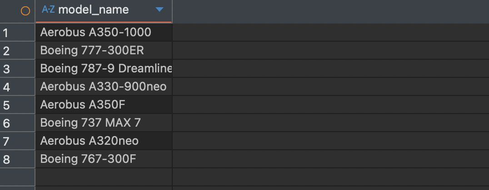

---

### Задание 2

Вывести количество самолетов, чья дальность перелетов меньше 4000.

- Запрос:

```sql
SELECT COUNT(*)
FROM prod.airplanes_data
WHERE range < 4000;
```

- Результат запроса:

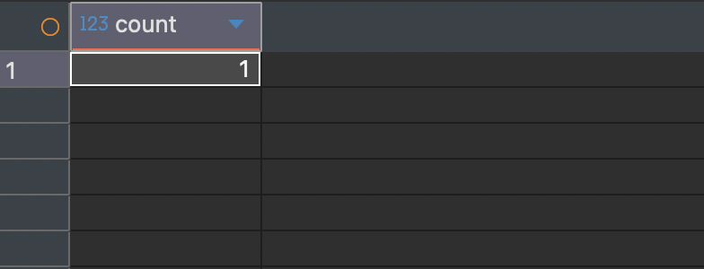

---

### Задание 3

Получить список рейсов, которые не состоялись.

- Запрос:

```sql
SELECT flight_id,
       route_no
FROM prod.flights
WHERE status = 'Cancelled'
ORDER BY flight_id
LIMIT 10;
```

- Результат запроса:

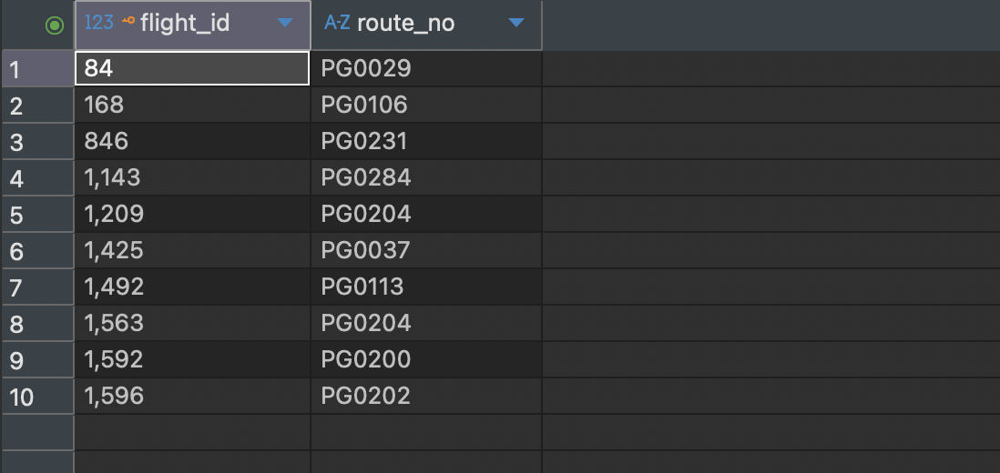

---

### Задание 4

Узнать коды и названия всех аэропортов Москвы.

- Запрос:

```sql
SELECT 
	airport_code,
	airport_name->>'ru' AS ru_airport_name,
	airport_name->>'en' AS en_airport_name
FROM airports_data
WHERE city->>'en' = 'Moscow'
ORDER BY airport_code;
```

- Результат запроса:

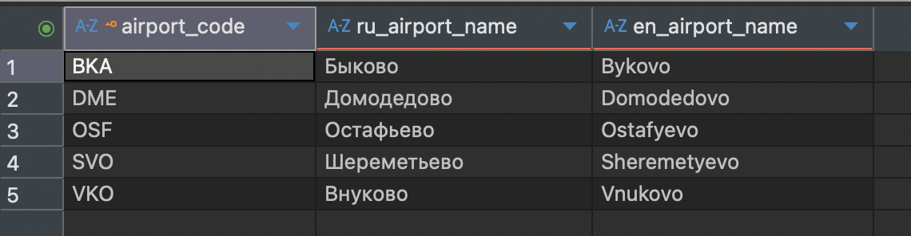

---

### Задание 5

Подсчитать количество мест в бизнес-классе самолета '32N'.

- Запрос:

```sql
SELECT COUNT(*) AS business_seat_count
FROM prod.seats
WHERE airplane_code = '32N'
  AND fare_conditions = 'Business';
```

- Результат запроса:

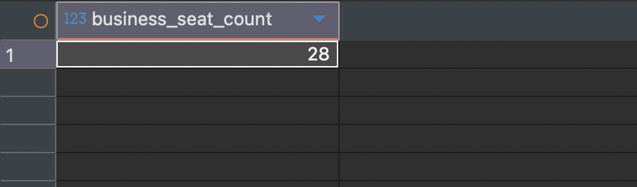

---

### Задание 6

Вывести 5 самых недорогих покупок в системе.

- Запрос:

```sql
SELECT book_ref,
       total_amount,
       book_date
FROM prod.bookings
ORDER BY total_amount
LIMIT 5;
```

- Результат запроса:

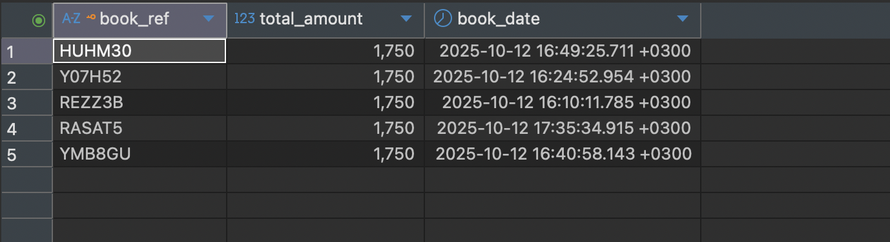

---

### Задание 7

Найти все самолеты модели Боинг.

- Запрос:

```sql
SELECT airplane_code,
       model->>'ru' AS ru_model_name
FROM prod.airplanes_data
WHERE model->>'ru' LIKE 'Боинг%';
```

- Результат запроса:

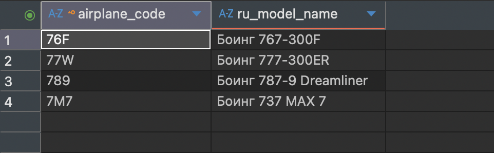

---

### Задание 8

Вывести дату самого первого бронирования и дату самого последнего бронирования.

- Запрос:

```sql
SELECT MIN(book_date) AS first_booking,
       MAX(book_date) AS last_booking
FROM prod.bookings;
```

- Результат запроса:


---

### Задание 9

Вывести количество аэропортов в каждом часовом поясе.

- Запрос:

```sql
SELECT timezone,
       COUNT(airport_code) AS airport_count
FROM prod.airports_data
GROUP BY timezone
ORDER BY airport_count DESC;
```

- Результат запроса:

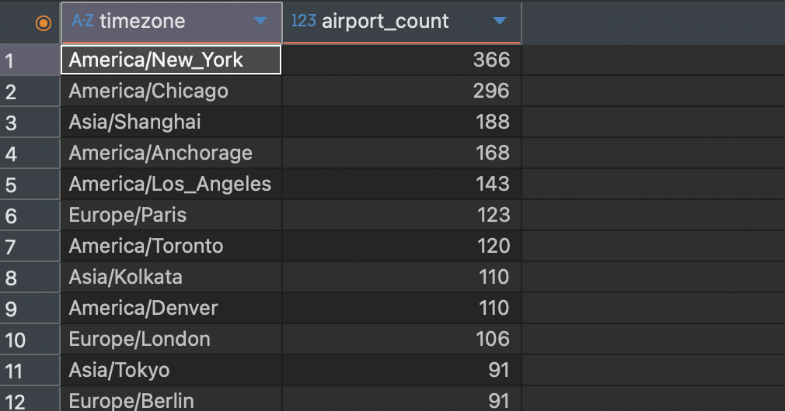

---

### Задание 10

Найти 10 пассажиров с самыми короткими именами.

- Запрос:

```sql
SELECT 
       passenger_name,
       passenger_id
FROM prod.tickets
ORDER BY LENGTH(SPLIT_PART(passenger_name, ' ', 1))
LIMIT 10;
```

- Результат запроса:

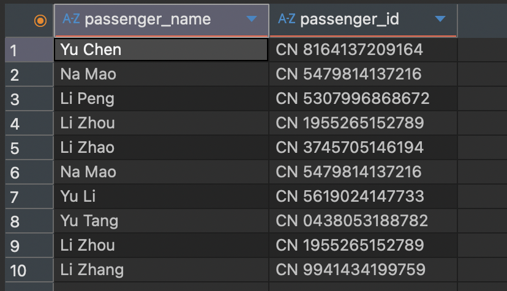

---

### Задание 11

Рассчитать среднюю стоимость билета без учета классов.

- Запрос:

```sql
SELECT ROUND(AVG(price), 2) AS average_ticket_price
FROM prod.segments;
```

- Результат запроса:


---

### Задание 12

Рассчитать среднюю стоимость билета с учетом классов.

- Запрос:

```sql
SELECT fare_conditions,
       ROUND(AVG(price), 2) AS average_price
FROM prod.segments
GROUP BY fare_conditions
ORDER BY average_price DESC;
```

- Результат запроса:

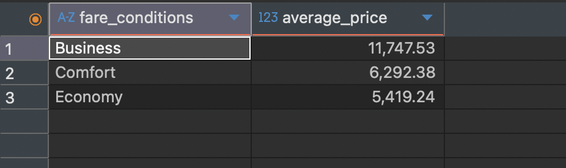

---

### Задание 13

Найти рейсы с самой большой выручкой.

- Запрос:

```sql
SELECT flight_id,
       SUM(price) AS revenue
FROM prod.segments
GROUP BY flight_id
HAVING SUM(price) > 20000000
ORDER BY revenue DESC;
```

- Результат запроса:

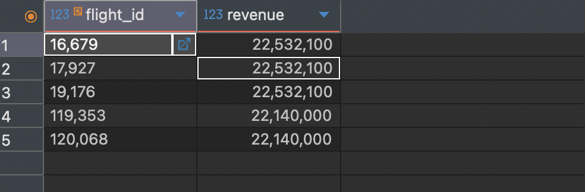

---

### Задание 14

Вывести список всех городов без повторов.

- Использовал JOIN, чтобы вывести названия городов, а не только коды аэропортов.

- Запрос:

```sql
SELECT DISTINCT city->>'ru' AS ru_town_name
FROM prod.routes r
JOIN prod.airports_data ad
    ON r.arrival_airport = ad.airport_code
ORDER BY ru_town_name;
```

- Результат запроса:

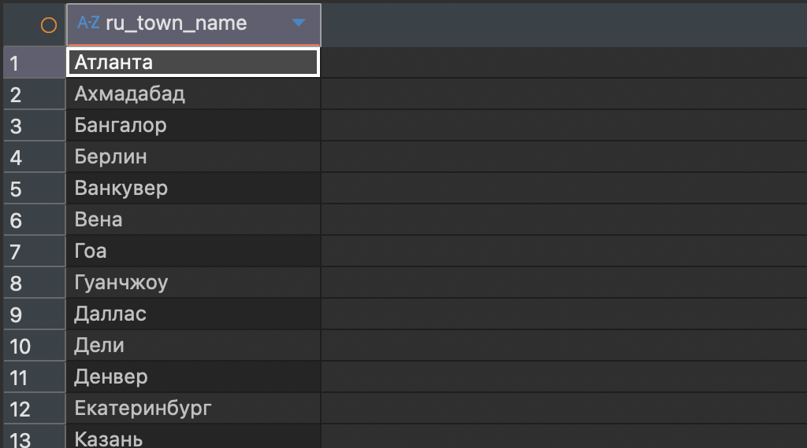

---

### Задание 15

Посчитать количество рейсов в каждом статусе.

- Запрос:

```sql
SELECT status,
       COUNT(status) AS status_count
FROM prod.flights
GROUP BY status
ORDER BY status_count DESC;
```

- Результат запроса:

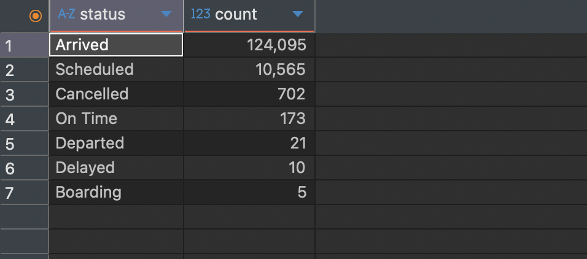

---

### Задание 16

Найти 5 самых быстрых самолетов.

- Запрос:

```sql
SELECT airplane_code,
       model->>'ru' AS ru_model,
       speed
FROM prod.airplanes_data
ORDER BY speed DESC,
         ru_model
LIMIT 5;
```

- Результат запроса:

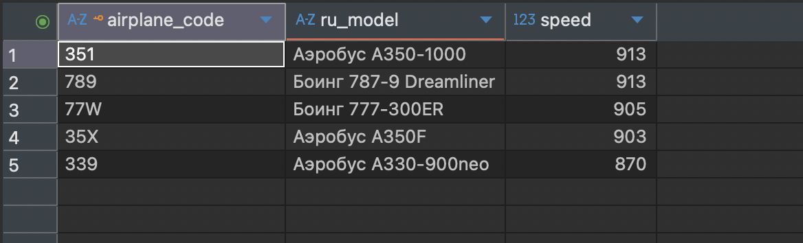

---

### Задание 17

Найти общую стоимость всех проданных билетов.

- Запрос:

```sql
SELECT SUM(total_amount) AS total_revenue
FROM prod.bookings;
```

- Результат запроса:


---

### Задание 18

Получить имя и данные документа пассажира по номеру билета.

- Запрос:

```sql
SELECT passenger_name,
       passenger_id
FROM prod.tickets
WHERE ticket_no = '0005432000284';
```

- Результат запроса:

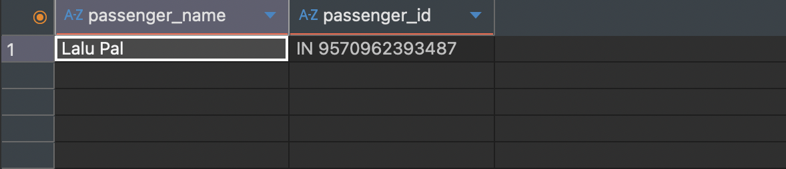

---

### Задание 19

Вывести все возможные тарифы классов обслуживания.

- Запрос:

```sql
SELECT DISTINCT fare_conditions
FROM prod.seats;
```

- Результат запроса:

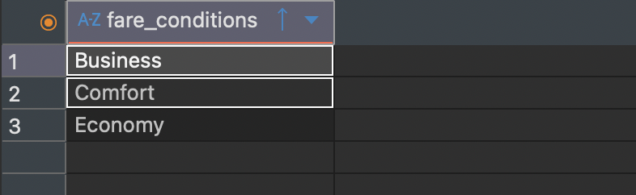

---

### Задание 20

Найти все аэропорты, работающие по московскому времени.

- Запрос:

```sql
SELECT 
	airport_code,
	airport_name->>'ru' as name,
	city->>'ru' as city
FROM airports_data
WHERE timezone = 'Europe/Moscow'
ORDER BY airport_code;
```

- Результат запроса:

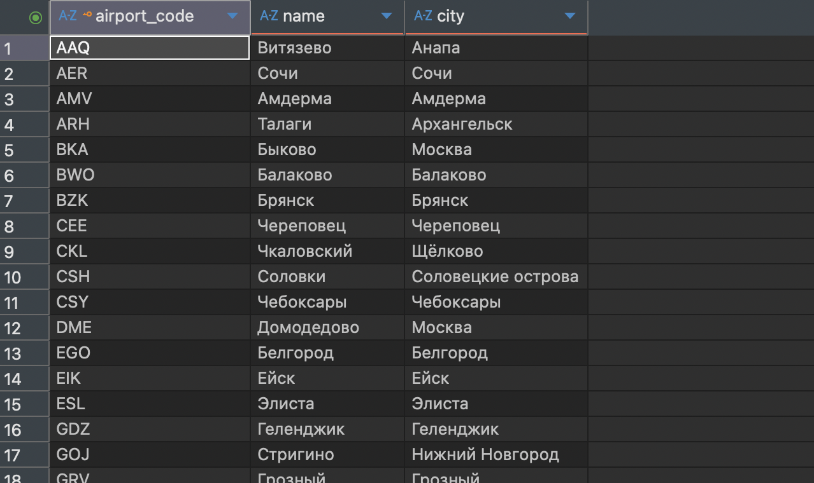

---

### Задание 21

Вывести все билеты и имена пассажиров в бронировании KOS1KJ.

- Запрос:

```sql
SELECT ticket_no,
       passenger_name
FROM prod.tickets
WHERE book_ref = 'KOS1KJ';
```

- Результат запроса:

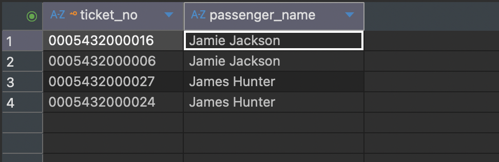

---

### Задание 22

Вывести 5 маршрутов с наибольшей продолжительностью.

- Запрос:

```sql
SELECT route_no,
       departure_airport,
       arrival_airport,
       duration
FROM prod.routes
ORDER BY duration DESC,
         route_no DESC
LIMIT 5;
```

- Результат запроса:

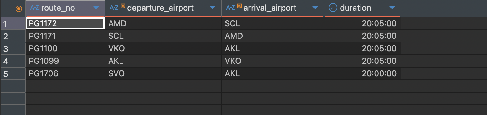

---

### Задание 23

Найти 12 аэропортов с самым большим количеством уникальных исходящих маршрутов.

- Использовал JOIN, чтобы вывести названия аэропортов, а не только их коды.

- Запрос:

```sql
SELECT ad.airport_name->>'en' AS airport_name,
       r.departure_airport AS airport_code,
       COUNT(DISTINCT arrival_airport) AS cnt
FROM prod.routes r
JOIN prod.airports_data ad
    ON r.departure_airport = ad.airport_code
GROUP BY ad.airport_name->>'en',
         r.departure_airport
ORDER BY cnt DESC
LIMIT 12;
```

- Результат запроса:

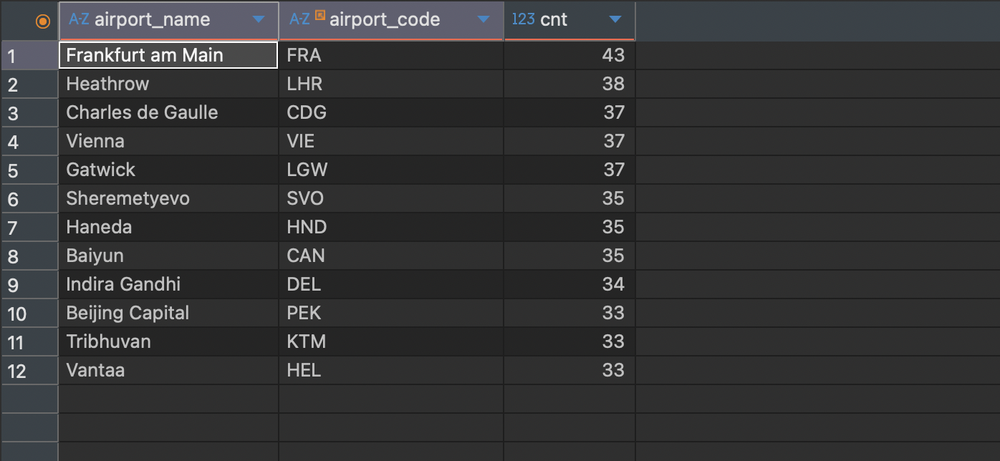

## SQL 2-я неделя. Множества, условия, соединения - CBR-2763

### Задание 1

Вывести уникальный список аэропортов. В таблице routes (маршруты) есть коды аэропортов вылета (departure_airport) и прилета (arrival_airport). Напиши запрос, который вернет единый столбец (airport_code) с уникальными кодами всех аэропортов, которые задействованы в маршрутах (то есть являются либо пунктом отправления, либо пунктом назначения). Атрибут назови airport_code, отсортируй по алфавиту.

- Запрос:

```sql
SELECT DISTINCT airport_code
FROM (
	SELECT departure_airport as airport_code
	FROM prod.routes
	
	UNION
	
	SELECT arrival_airport as airport_code
	FROM prod.routes
) AS all_airports
ORDER BY airport_code;
```
- Результат запроса:

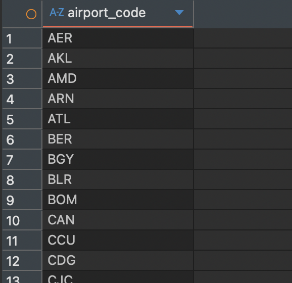

---

### Задание 2

Сформировать полный лог событий. Аналитикам понадобился единый хронологический список всех плановых взлетов и посадок для табло. Сформируй таблицу из трех колонок: номер рейса (flight_id), тип события (строка 'Departure' или 'Arrival') и плановое время события (event_time). Данные нужно взять из таблицы flights. Отсортируй результат по времени.

- Запрос:

```sql
SELECT *
FROM (
	SELECT	
		flight_id,
		'Departure' as event_type,
		scheduled_departure as event_time
	FROM prod.flights
	
	UNION ALL
	
	SELECT
		flight_id,
		'Arrival' as event_type,
		scheduled_arrival as event_time
	FROM prod.flights
)
ORDER BY event_time;
```
- Результат запроса:

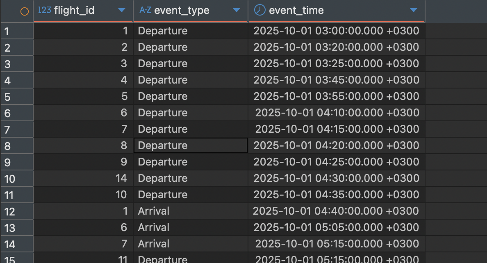

---

### Задание 3

Самолеты с бизнес- и комфорт-классом. У разных самолетов (airplane_code) разная компоновка мест (seats). Напиши запрос, который выведет коды только тех самолетов, у которых есть и места класса 'Business', и места класса 'Comfort'.

- Запрос:

```sql
SELECT DISTINCT ad.airplane_code 
FROM prod.airplanes_data ad 
JOIN prod.seats s 
	ON ad.airplane_code = s.airplane_code
WHERE s.fare_conditions IN ('Business', 'Comfort');
```
- Результат запроса:

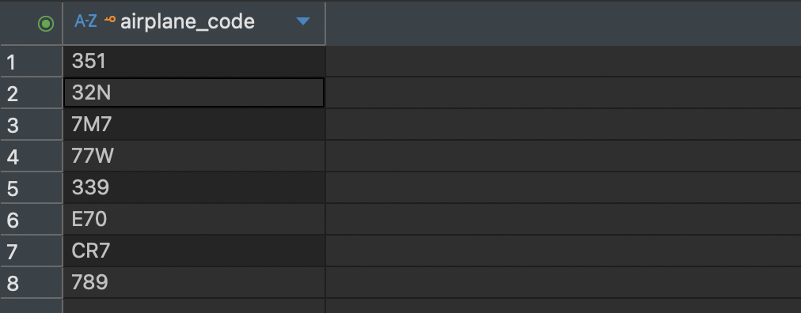

---

### Задание 4

Напиши запрос, который выведет все свободные места (seat_no) для рейса flight_id = 1275.


- Запрос:

Первая CTE для поиска всех мест в самолете рейса 1275. Вторая - находит только занятые места для рейса. Далее находим те места, котоые были не заняты.

```sql
SELECT DISTINCT s.seat_no
FROM prod.flights AS f
JOIN prod.routes AS r
    ON f.route_no = r.route_no
JOIN prod.seats AS s
    ON r.airplane_code = s.airplane_code
LEFT JOIN prod.boarding_passes AS bp
    ON f.flight_id = bp.flight_id
   AND s.seat_no = bp.seat_no
WHERE f.flight_id = 1275
  AND bp.seat_no IS NULL
ORDER BY s.seat_no;
```
- Результат запроса:

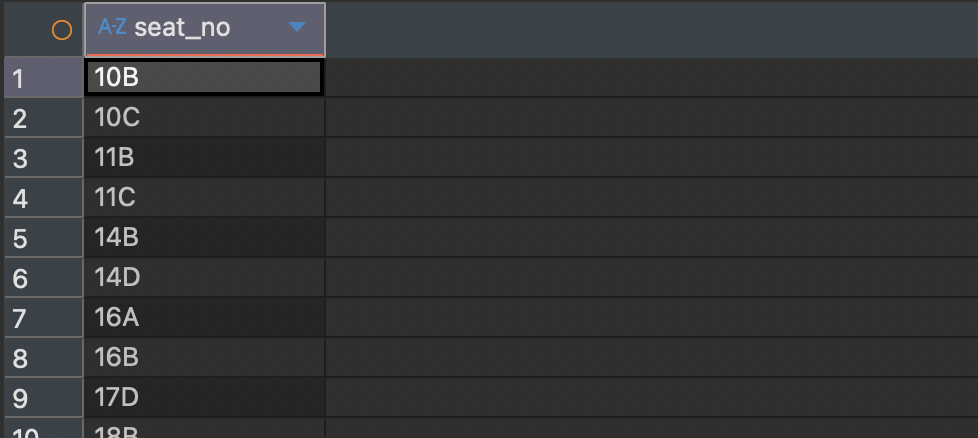

---

### Задание 5

В таблице билетов есть логическое (boolean) поле outbound, которое определяет направление: true для билета «туда» и false для билета «обратно». Выведи номера билетов, имена пассажиров и добавь новый столбец direction, в котором вместо true/false будет написано 'Туда' или 'Обратно'.


- Запрос:

```sql
SELECT 
	ticket_no,
	passenger_name,
	CASE
		WHEN outbound = true THEN 'Туда'
		WHEN outbound = false THEN 'Обратно'
	END AS direction
FROM prod.tickets;
```
- Результат запроса:

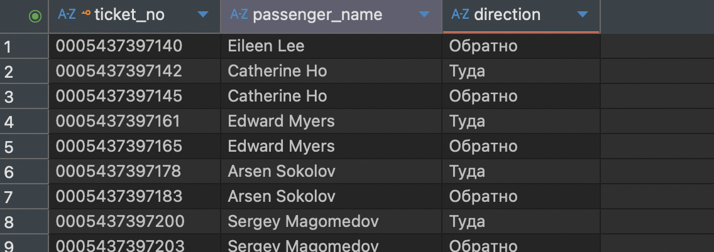

---

### Задание 6

Выведи код самолета, модель и новый столбец range_category со следующей логикой:

До 4000 км — 'Ближнемагистральный'

От 4000 до 8000 км (включительно) — 'Среднемагистральный'

Более 8000 км — 'Дальнемагистральный'

Отсортируй в порядке возрастания дальности.

- Запрос:

```sql
SELECT 
	airplane_code,
	model->>'en' as model,
	CASE
		WHEN range < 4000 THEN 'Ближнемагистральный'
		WHEN range BETWEEN 4000 and 8000 THEN 'Среднемагистральный'
		WHEN range > 8000 THEN 'Дальнемагистральный'
	END as range_category
FROM prod.airplanes_data
ORDER BY range;
```
- Результат запроса:

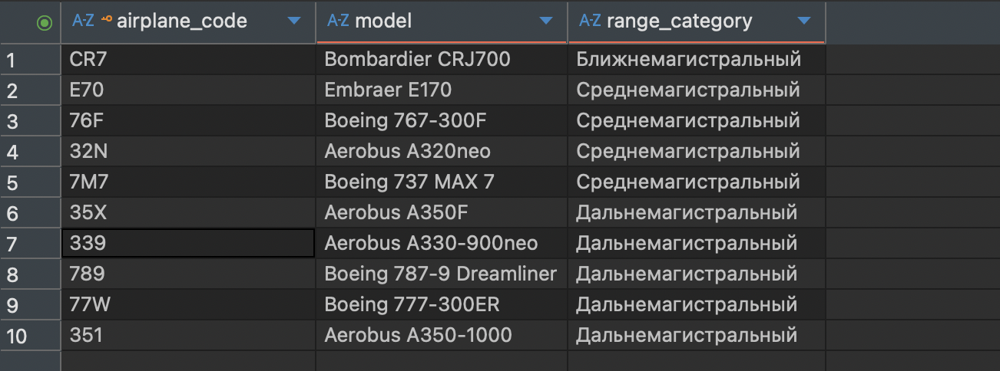

---

### Задание 7

У рейса несколько возможных статусов. Для табло на главной странице сайта нужны более простые категории. Выведи flight_id, оригинальный status, новый столбец simple_status и scheduled_departure. При этом столбец simple_status - это:

Если статус Scheduled, On Time или Delayed — пишем 'Ожидается'

Если Boarding или Departed — пишем 'В процессе'

Если Arrived — пишем 'Завершен'

Если Cancelled — пишем 'Отменен'.

Оставь только рейсы, чей scheduled_departure был не раньше, чем 3 дня назад от текущего момента.
Подсказка: Для текущего времени используй системную функцию bookings.now() или prod.now(), а не стандартную NOW(). Чтобы вычесть 3 дня можно от текущей даты отнять 3 (-3). Или использовать синтаксис - INTERVAL.

Отсортировать в порядке убывания времени прибытия.

- Запрос:

```sql
SELECT
	flight_id,
	status,
	CASE
		WHEN status = 'Scheduled' OR status = 'On Time' OR status = 'Delayed' THEN 'Ожидается'
		WHEN status = 'Boarding' OR status = 'Departed' THEN 'В процессе'
		WHEN status = 'Arrived' THEN 'Завершен'
		WHEN status = 'Cancelled' THEN 'Отменен'
	END as simple_status,
	scheduled_departure 
FROM prod.flights
WHERE scheduled_departure > prod.now() - INTERVAL '3 days'
ORDER BY scheduled_departure DESC;
```
- Результат запроса:

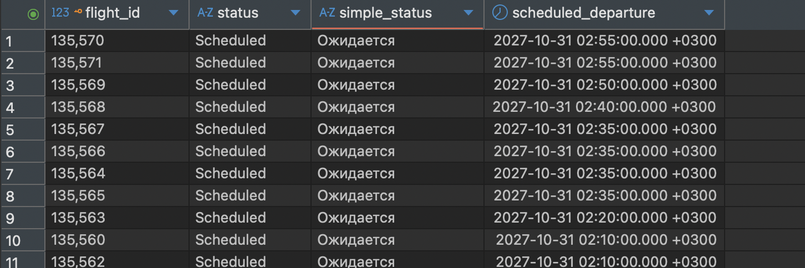

---

### Задание 8

Служба безопасности просит подсветить потенциально ошибочные цены на перелеты (price). Выведи номер билета, рейс, класс обслуживания (fare_conditions), цену и столбец price_alert:

Если класс 'Economy', а цена больше 50000 — 'Подозрительно дорогой эконом'

Если класс 'Business', а цена меньше 15000 — 'Подозрительно дешевый бизнес'

В остальных случаях — 'Норма'

- Запрос:

```sql
SELECT 
	ticket_no,
	flight_id,
	fare_conditions,
	price,
	CASE
		WHEN price > 5000 AND fare_conditions = 'Economy' THEN 'Подозрительно дорогой эконом'
		WHEN price < 15000 AND fare_conditions = 'Business' THEN 'Подозрительно дешевый бизнес'
		ELSE 'Норма'
	END as price_alert
FROM prod.segments;
```
- Результат запроса:

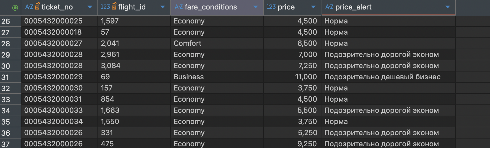

---

### Задание 9

Определить, в какое время суток вылетают рейсы, используя местное время вылета (scheduled_departure_local), которое нам любезно считает представление timetable. Используя функцию EXTRACT(hour FROM ...), выведи flight_id, scheduled_departure_local и столбец time_of_day:

С 6 до 11 часов — 'Утро'

С 12 до 17 часов — 'День'

С 18 до 23 часов — 'Вечер'

Остальное (с 0 до 5) — 'Ночь'

- Запрос:

```sql
SELECT 
	flight_id,
	scheduled_departure_local,
	CASE
		WHEN EXTRACT(hour FROM scheduled_departure_local) BETWEEN 6 AND 11 THEN 'Утро' 
		WHEN EXTRACT(hour FROM scheduled_departure_local) BETWEEN 12 AND 17 THEN 'День'
		WHEN EXTRACT(hour FROM scheduled_departure_local) BETWEEN 18 AND 23 THEN 'Вечер'
		ELSE 'Ночь'
	END as time_of_day
FROM prod.timetable;
```
- Результат запроса:

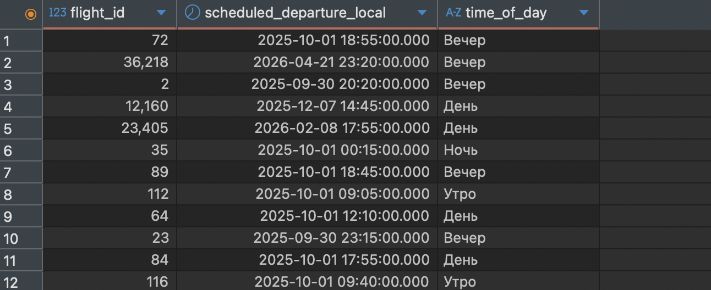

---

### Задание 10

Продолжение задания 9: Посчитай, сколько всего рейсов запланировано на утро, день, вечер и ночь. Используй представление timetable и местное время вылета (scheduled_departure_local). 

Выведи два столбца: time_of_day и flights_count (количество рейсов).

Логика для времени суток осталась прежней:

6–11 часов → 'Утро'

12–17 часов → 'День'

18–23 часов → 'Вечер'

Остальное (0–5) → 'Ночь'

Отсортируй результат по количеству рейсов по убыванию.

- Запрос:

```sql
SELECT 
	CASE
		WHEN EXTRACT(hour FROM scheduled_departure_local) BETWEEN 6 AND 11 THEN 'Утро' 
		WHEN EXTRACT(hour FROM scheduled_departure_local) BETWEEN 12 AND 17 THEN 'День'
		WHEN EXTRACT(hour FROM scheduled_departure_local) BETWEEN 18 AND 23 THEN 'Вечер'
		ELSE 'Ночь'
	END as time_of_day,
	COUNT(*) as flights_count
FROM prod.timetable
GROUP BY time_of_day
ORDER BY flights_count DESC;
```
- Результат запроса:

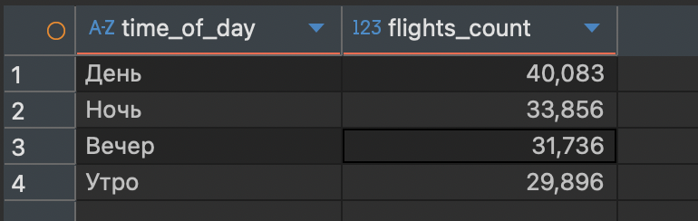

---

### Задание 11

Выведи список всех самолетов (код и модель) и количество мест в них. Таблицы: airplanes и seats. Отсортируй в порядке убывания кол-ва мест.

- Запрос:

```sql
SELECT 
	ad.airplane_code,
	model->>'en' as model,
	COUNT(ad.airplane_code) as seats_count
FROM prod.airplanes_data ad
JOIN prod.seats s 
	ON ad.airplane_code = s.airplane_code
GROUP BY ad.model, ad.airplane_code 
ORDER BY seats_count DESC;
```
- Результат запроса:

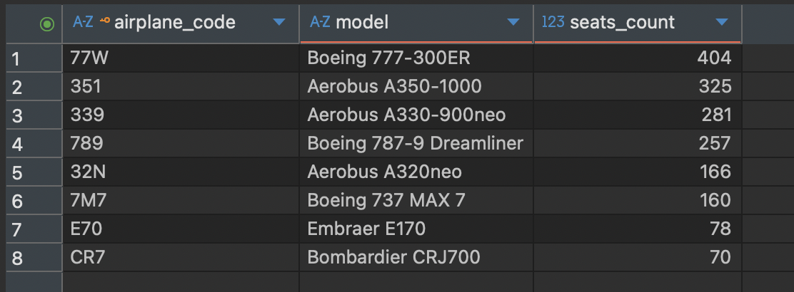

---

### Задание 12

Покажи номера бронирований, даты покупки, общую сумму чека (total_amount) и имена всех пассажиров в этих бронированиях.

Ограничения:
1. Оставь только те бронирования, сумма которых превышает 900 000.
2. Отсортируй результат по убыванию суммы.
3. Выведи только Топ-10 строк

- Запрос:

```sql
SELECT 
    b.book_ref,
    b.book_date,
    b.total_amount,
    STRING_AGG(t.passenger_name, ', ') AS passengers
FROM prod.bookings b
JOIN prod.tickets t
    ON b.book_ref = t.book_ref
WHERE b.total_amount > 900000
GROUP BY b.book_ref, b.book_date, b.total_amount
ORDER BY b.total_amount DESC
LIMIT 10;
```
- Результат запроса:

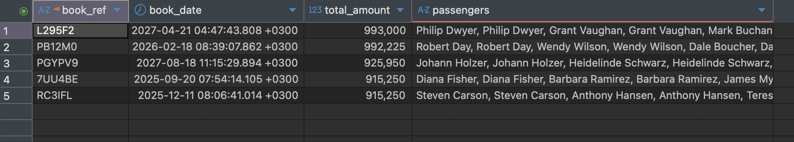

---

### Задание 13

Выведи номер маршрута (route_no), название города вылета и города прилета. Для этого таблицу routes нужно соединить со справочником airports дважды (для departure_airport и для arrival_airport).

- Запрос:

```sql
SELECT 
	r.route_no,
	ad.city->>'en' as departure_city,
	ad2.city->>'en' as arrival_city
FROM prod.routes r 
JOIN prod.airports_data ad 
	ON r.departure_airport = ad.airport_code
JOIN prod.airports_data ad2 
	ON r.arrival_airport = ad2.airport_code;
```
- Результат запроса:

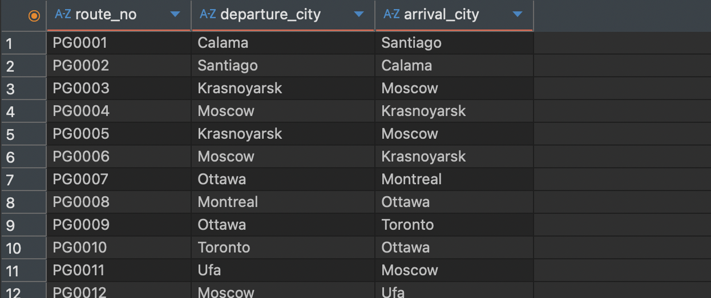

---

### Задание 14

Для рейса с flight_id = 123 выведи номера билетов, имена пассажиров и их класс обслуживания (fare_conditions). Таблицы: flights, segments, tickets.

- Запрос:

Так как ключи в таблицах сходятся и используется INNER JOIN, то вспомнил про NATURAL JOIN.

```sql
SELECT
	t.ticket_no,
	t.passenger_name,
	s.fare_conditions
FROM prod.flights f 
NATURAL JOIN prod.segments s
NATURAL JOIN prod.tickets t
WHERE f.flight_id = 123;
```
- Результат запроса:

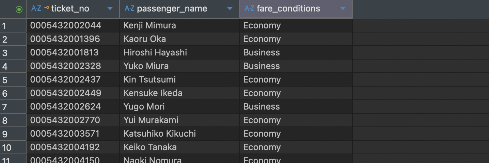

---

### Задание 15

Решим задачу поиска свободных мест через LEFT JOIN. Возьми все места модели самолета, выполняющей рейс flight_id = 23405 (через timetable и seats), и с помощью LEFT JOIN к boarding_passes найди те, где талона нет (boarding_no IS NULL).

- Запрос:

```sql
SELECT s.seat_no 
FROM prod.timetable t 
JOIN prod.seats s 
	ON t.airplane_code = s.airplane_code 
LEFT JOIN prod.boarding_passes bp 
	ON s.seat_no = bp.seat_no
	AND t.flight_id = bp.flight_id
WHERE t.flight_id = 23405 AND bp.seat_no IS NULL;
```
- Результат запроса:

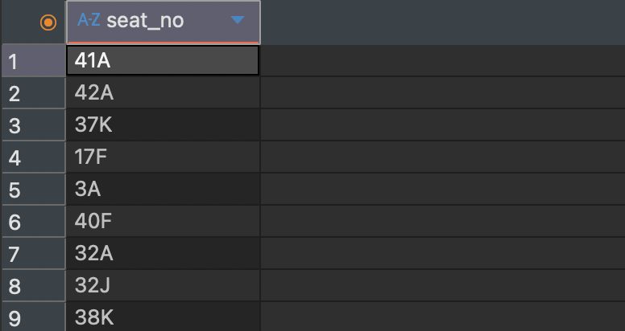

---

### Задание 16

Посчитай, сколько реальных рейсов (flights) было запланировано для каждой модели самолета (model). Таблицы: airplanes, routes, flights

- Запрос:

```sql
SELECT 
	ad.model->>'en' as model_name,
	COUNT(*) as flights_count
FROM prod.flights f
JOIN prod.routes r 
	ON f.route_no = r.route_no 
JOIN prod.airplanes_data ad 
	ON r.airplane_code = ad.airplane_code 
WHERE status = 'Scheduled'
GROUP BY ad.model->>'en'
ORDER BY flights_count DESC
```
- Результат запроса:

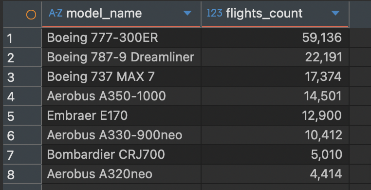

---

### Задание 17

Выведи полный маршрутный лист для билета с номером '0005432000987': имя пассажира, номер рейса, плановое время вылета, город отправления и город прибытия. Таблицы: tickets, segments, flights, routes, airports (дважды для городов).

- Запрос:

```sql
SELECT DISTINCT
	t.passenger_name,
	f.route_no,
	f.scheduled_departure,
	ad1.city->>'en' as departure,
	ad2.city->>'en' as arival
FROM prod.tickets t 
JOIN prod.segments s 
	ON t.ticket_no = s.ticket_no 
JOIN prod.flights f
	ON s.flight_id = f.flight_id
JOIN prod.routes r 
	ON f.route_no = r.route_no
JOIN prod.airports_data ad1
	ON r.departure_airport = ad1.airport_code 
JOIN prod.airports_data ad2
	ON r.arrival_airport = ad2.airport_code 
WHERE t.ticket_no = '0005432000987';
```
- Результат запроса:

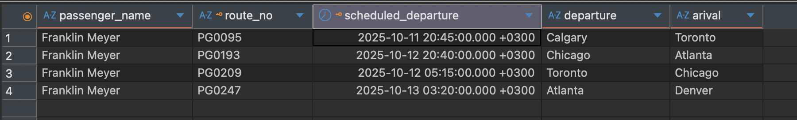

## SQL 3-я неделя. Подзапросы, обобщенные табличные выражения - CBR-2762

### Задание 1

Вывести самолеты с дальностью выше среднего: код самолета, модель на русском и дальность полета.

- Запрос:

```sql
SELECT
	airplane_code,
	model->>'ru' as model_name_ru,
	range
FROM prod.airplanes_data
WHERE range > (SELECT AVG(range) FROM prod.airplanes_data)
ORDER BY range DESC;
```
- Результат запроса:

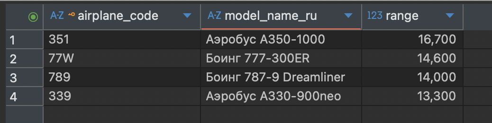

---

### Задание 2

Найти бронирование конкретного пассажира. Мистер 'Franklin Meyer' обратился в поддержку, но забыл номера своих бронирований. Найти все бронирования (book_ref и total_amount из таблицы bookings), в которых есть хотя бы один билет, оформленный на имя 'Franklin Meyer'.

- Запрос:

```sql
SELECT 
	book_ref,
	total_amount 
FROM prod.bookings
WHERE book_ref IN (
	SELECT book_ref 
	FROM prod.tickets
	WHERE passenger_name = 'Franklin Meyer'
	);
```
- Результат запроса:

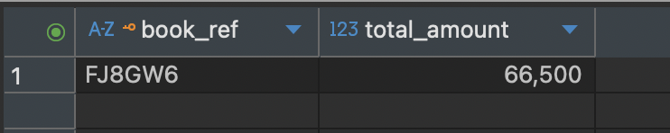

---

### Задание 3

Найти и вывести только одно значение — вторую по величине максимальную цену перелета из таблицы segments. Решить с использованием подзапроса.

- Запрос:

```sql
SELECT MAX(price) as second_max
FROM prod.segments 
WHERE price < (SELECT MAX(price) FROM prod.segments);
```
- Результат запроса:


---

### Задание 4

Подзапросы можно писать прямо в списке вывода SELECT. Выведи номер бронирования (book_ref), его общую стоимость (total_amount) и количество билетов внутри этого бронирования. Сортировка по кол-ву билетов внутри бронирования в порядке убывания. Ограничение в выборке 10 строк.

Подсказка: В секции SELECT напиши подзапрос, который делает COUNT(*) из таблицы tickets, где book_ref равен book_ref из внешнего запроса

- Запрос:

```sql
SELECT
	book_ref,
	total_amount,
	(SELECT COUNT(*) FROM prod.tickets t WHERE t.book_ref = b.book_ref) as ticket_num
FROM prod.bookings b
ORDER BY ticket_num DESC
LIMIT 10;
```
- Результат запроса:

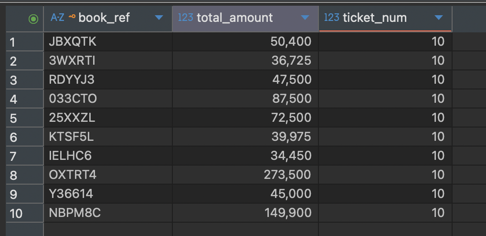

---

### Задание 5

Выведи идентификатор рейса, время вылета и общую сумму выручки, но только для тех рейсов, где выручка превысила 15 000 000.

- Запрос:

```sql
WITH flight_revenue AS (
    SELECT 
        flight_id,
        SUM(price) AS revenue
    FROM prod.segments
    GROUP BY flight_id
)
SELECT 
    f.flight_id,
    COALESCE(f.actual_departure, f.scheduled_departure) AS departure_time,
    fr.revenue
FROM prod.flights f
JOIN flight_revenue fr
    ON fr.flight_id = f.flight_id
WHERE fr.revenue > 15000000;
```
- Результат запроса:

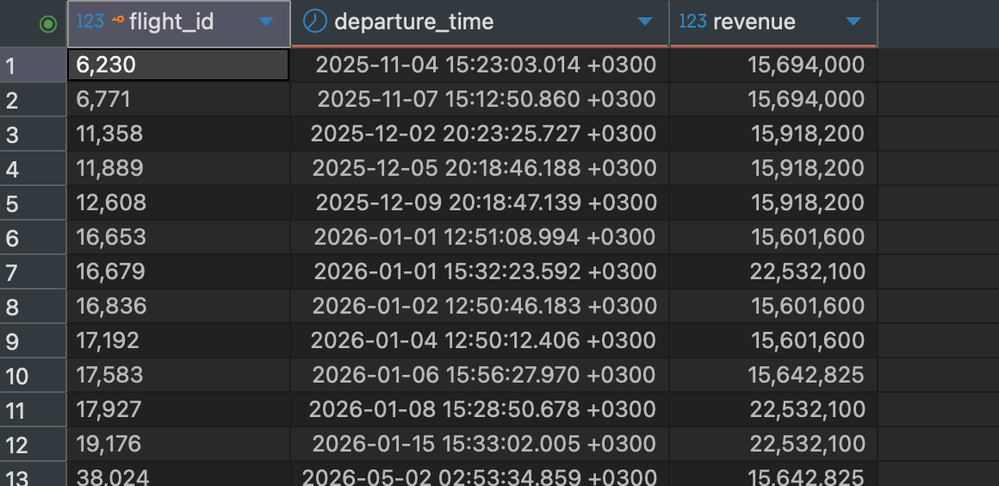

---

### Задание 6

Выведи список уже вылетевших или прибывших рейсов (status 'Departed' или 'Arrived') и количество фактически посаженных на них пассажиров.

- Запрос:

```sql
WITH total_pass AS (
    SELECT 
        bp.flight_id,
        COUNT(*) AS total_passengers
    FROM prod.boarding_passes bp 
    GROUP BY bp.flight_id
)
SELECT 
    f.flight_id,
    f.route_no,
    f.status,
    f.scheduled_departure,
    f.scheduled_arrival,
    f.actual_departure,
    f.actual_arrival,
    tp.total_passengers
FROM prod.flights f
JOIN total_pass tp
    ON f.flight_id = tp.flight_id
WHERE status = 'Departed' OR status = 'Arrived';
```
- Результат запроса:

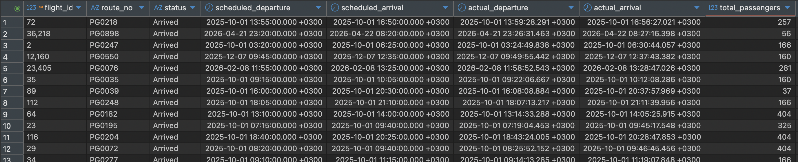

---

### Задание 7

Найди Топ-5 рейсов с максимальной задержкой вылета

- Запрос:

```sql
SELECT 
	flight_id,
	route_no,
	scheduled_departure,
	actual_departure,
	actual_departure - scheduled_departure as departure_delay
FROM prod.flights
WHERE actual_departure IS NOT NULL
ORDER BY departure_delay DESC
LIMIT 5;
```
- Результат запроса:

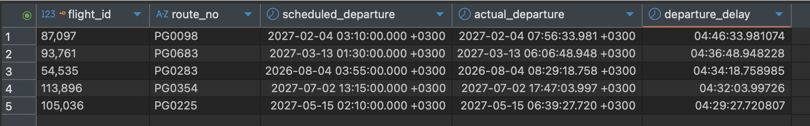

---

### Задание 8

Рассчитай процент заполняемости для каждого рейса, на который уже выданы посадочные талоны.

- Запрос:

Первая CTE all_seats находит все места, которые могут быть в каждом рейсе. Вторая - только места, которые реально были заняты. Далее запросом через JOIN выводим остальную информацию и считаем процент заполняемости для каждого рейса.

```sql
WITH all_seats AS (
	SELECT
	    f.flight_id,
	    COUNT(s.seat_no) AS total_seats
	FROM prod.flights f
	JOIN prod.routes r
	    ON r.route_no = f.route_no
	   AND f.scheduled_departure <@ r.validity
	JOIN prod.seats s
	    ON s.airplane_code = r.airplane_code
	GROUP BY f.flight_id
	),
booked_seats AS (
	SELECT 
	    bp.flight_id,
	    COUNT(*) AS occupied_seats
	FROM prod.boarding_passes bp
	GROUP BY bp.flight_id
	)

SELECT 
	a.flight_id,
	bs.occupied_seats,
	a.total_seats,
	ROUND(bs.occupied_seats * 100.0 / a.total_seats, 2) as occupancy_rate
FROM all_seats a
JOIN booked_seats bs
    ON bs.flight_id = a.flight_id;
```
- Результат запроса:

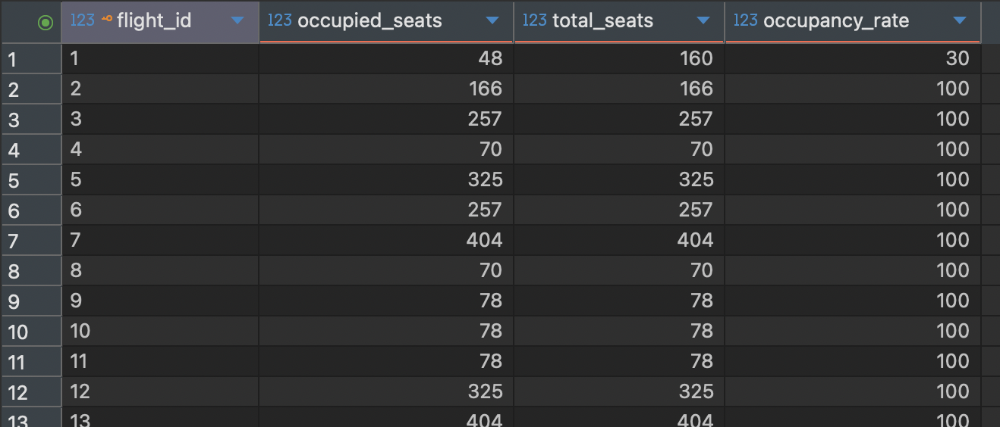

---

### Задание 9

Требуется определить среднюю стоимость перелета для каждого маршрута. Вывести номер маршрута, код аэропорта вылета, код аэропорта прилета и вычисленную среднюю цену.

- Запрос:

В первой CTE ищем среднюю стоимость по каждому маршруту. Во второй CTE находим уникальные маршруты с кодами аэропортов. Далее соединяем эти две CTE по номеру маршрута и выводим нужные столбцы.

```sql
WITH avg_price AS (
    SELECT
        f.route_no,
        ROUND(AVG(s.price), 2) AS avg_price
    FROM prod.flights f
    JOIN prod.segments s 
        ON s.flight_id = f.flight_id
    GROUP BY f.route_no
),
routes_unique AS (
    SELECT DISTINCT
        route_no,
        departure_airport,
        arrival_airport
    FROM prod.routes
)
SELECT
    r.route_no,
    r.departure_airport,
    r.arrival_airport,
    ap.avg_price
FROM routes_unique r
JOIN avg_price ap
    ON ap.route_no = r.route_no;
```
- Результат запроса:

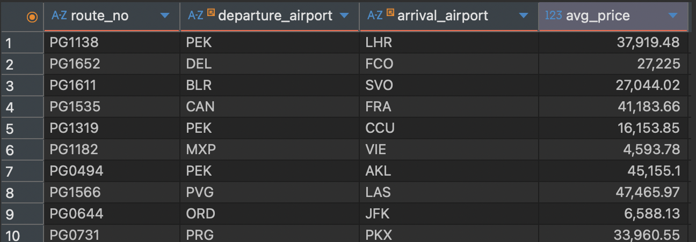

---

### Задание 10

Требуется вывести список аэропортов по количеству уникальных маршрутов, вылетающих из них. Вывести название аэропорта, город и количество маршрутов.

- Запрос:

```sql
SELECT 
	ad.airport_name ->> 'en' as airport_name,
	ad.city ->> 'en' as city,
	COUNT(DISTINCT r.route_no) as routes_count
FROM prod.routes r
JOIN prod.airports_data ad 
	ON r.departure_airport = ad.airport_code
GROUP BY 
	ad.airport_name ->> 'en',
	ad.city ->> 'en'
ORDER BY routes_count DESC;
```
- Результат запроса:

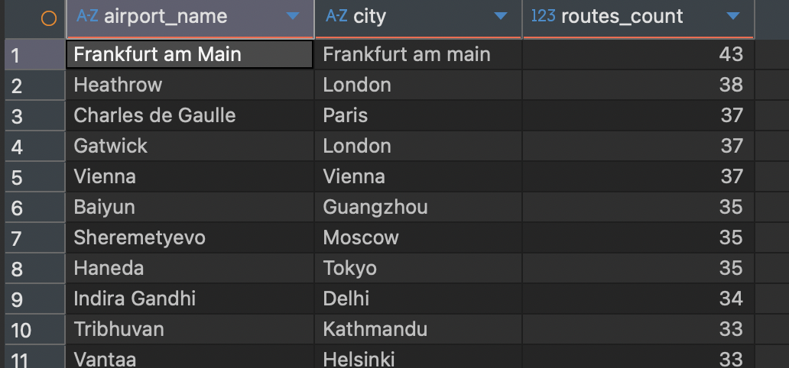

---

### Задание 11

Требуется рассчитать, какой процент от общей выручки каждого рейса составляет выручка от продажи билетов класса 'Business'. Вывести flight_id, общую выручку, выручку бизнес-класса и рассчитанный процент

- Запрос:

Считаем в первой CTE общую выручку по каждому рейсу, во второй - только по бизнес классу. Далее джойним 2 CTE, выводим нужные столбцы и расчитываем процент.

```sql
WITH total_revenue AS (
	SELECT 
		flight_id,
		SUM(price) as total_revenue
	FROM prod.segments
	GROUP BY flight_id
),
business_revenue AS (
	SELECT 
		flight_id,
		SUM(price) as business_revenue
	FROM prod.segments
	WHERE fare_conditions = 'Business'
	GROUP BY flight_id
)

SELECT 
	tr.flight_id,
	tr.total_revenue,
	br.business_revenue,
	ROUND(br.business_revenue * 100.0 / tr.total_revenue, 2) as business_percentage
FROM total_revenue tr
JOIN business_revenue br
	ON tr.flight_id = br.flight_id;
```
- Результат запроса:

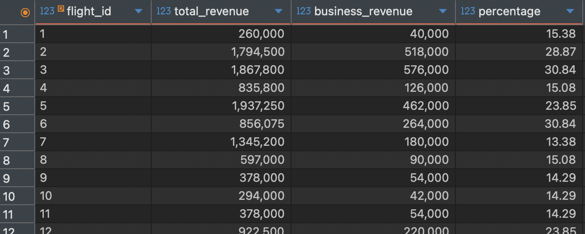

---

### Задание 12

Требуется сравнить реальное время нахождения самолета в воздухе с плановой продолжительностью маршрута. Вывести flight_id, фактическое время и плановое время (duration).

- Запрос:

```sql
SELECT
	f.flight_id,
	DATE_TRUNC('minute', f.actual_arrival  - f.actual_departure) as actual_time,
	r.duration as planned_time
FROM prod.flights f
JOIN prod.routes r 
	ON f.route_no = r.route_no
	AND f.scheduled_departure  <@ r.validity 
WHERE f.actual_departure IS NOT NULL
	AND f.actual_arrival IS NOT NULL;
```
- Результат запроса:

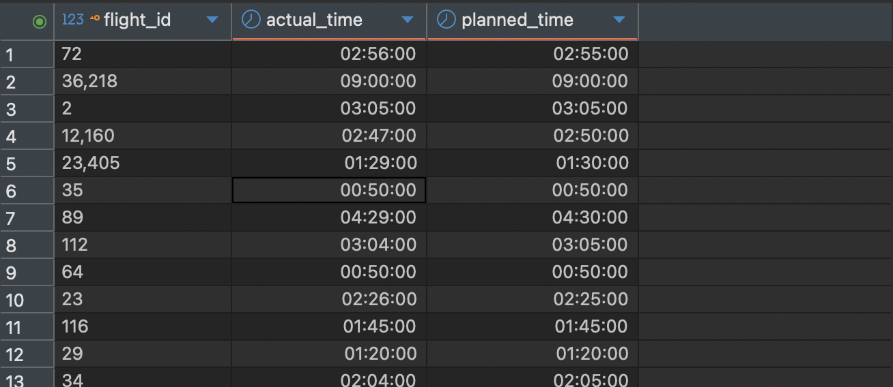

---

## SQL 4-я неделя. Оконные функции - CBR-2760

### Задание 1

Посчитай накопительный итог (running total) суммы бронирований (total_amount) по дням. Выведи дату и сумму, которая накопилась с начала продаж до этого дня включительно. Выведи первые 10 значений
(сначала сгруппируй выручку по дням в CTE, а затем примени оконную функцию к результату)

- Запрос:

```sql
WITH day_total AS (
	SELECT
		book_date::date as book_date,
		SUM(total_amount) as day_total
	FROM prod.bookings
	GROUP BY book_date::date
)

SELECT
	book_date,
	SUM(day_total) OVER(
		ORDER BY book_date
		ROWS BETWEEN UNBOUNDED PRECEDING AND CURRENT ROW) as running_total
FROM day_total;
```
- Результат запроса:

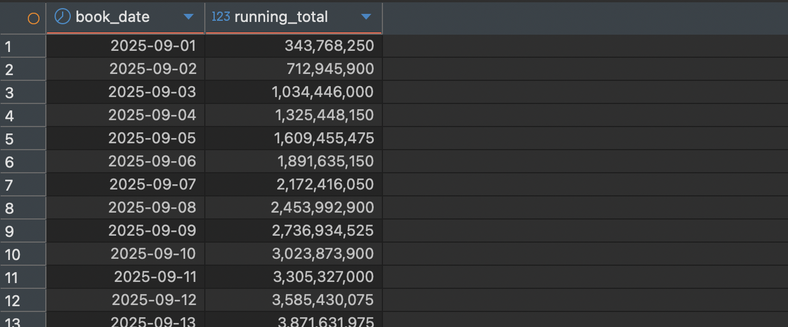

---

### Задание 2

Выведи flight_id, ticket_no и цену (price). Для каждого рейса найди три самых дорогих проданных билета. Если цены одинаковые, они должны делить одно место

- Запрос:

```sql
SELECT 
	ticket_no,
	flight_id,
	price
FROM (
	SELECT
		ticket_no,
		flight_id,
		price,
		DENSE_RANK() OVER (PARTITION BY flight_id ORDER BY price DESC) as rank
	FROM prod.segments
)
WHERE rank <= 3;
```
- Результат запроса:

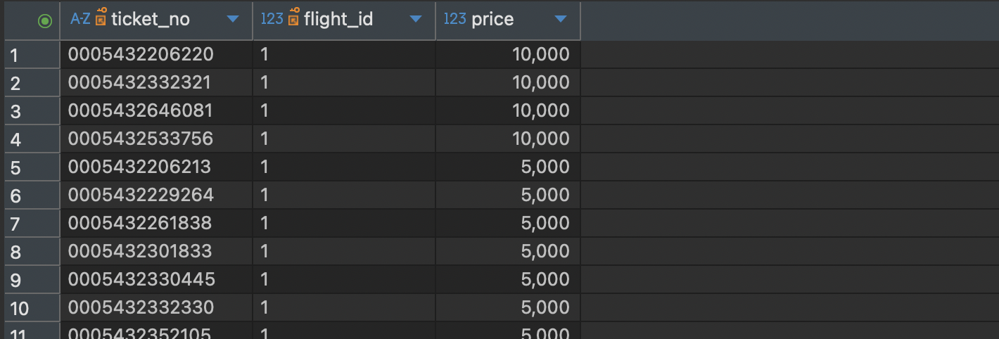

---

### Задание 3

Для каждого перелета в таблице segments выведи цену билета и среднюю цену билета в этом же классе обслуживания (fare_conditions). Добавь столбец с разницей: насколько этот конкретный билет дороже или дешевле среднего по классу. Цену округлить до 2 знаков после запятой. Дубликаты убрать с помощью оконной функции. Вывести строки flight_id, fare_conditions, price, avg_class_price, diff_from_avg. Отсортировать по номеру перелета, классу билета и цене (все по возрастанию)

Вывести первые 50 строк

- Запрос:

В подзапросе делаем все расчеты по столбцам и присваеваем rn (порядковый номер) для удаления дубликатов. А в самом запросе уже фильруем по rn = 1 и сортируем результат;

```sql
SELECT 
    flight_id,
    fare_conditions,
    price,
    avg_class_price,
    ROUND(price - avg_class_price, 2) AS diff_from_avg
FROM (
    SELECT 
        flight_id,
        fare_conditions,
        price,
        ROUND(AVG(price) OVER (PARTITION BY fare_conditions), 2) AS avg_class_price,
        ROW_NUMBER() OVER (
            PARTITION BY flight_id, fare_conditions, price 
            ORDER BY flight_id
        ) AS rn
    FROM prod.segments
)
WHERE rn = 1
ORDER BY flight_id, fare_conditions, price
LIMIT 50;
```
- Результат запроса:


---

### Задание 4

Для пассажира 'Franklin Meyer' рассчитай, сколько времени прошло между его предыдущим и текущим вылетом. Выведи имя, номер рейса, время вылета и новый столбец time_since_last_flight
(Используй функцию LAG, чтобы «заглянуть» в предыдущую строку)

- Запрос:

```sql
SELECT
	t.passenger_name,
	f.flight_id,
	f.actual_departure - LAG(actual_departure) OVER (ORDER BY actual_departure) as time_since_last_flight
FROM prod.tickets t 
	JOIN prod.segments s 
		ON t.ticket_no = s.ticket_no 
	JOIN prod.flights f 
		ON s.flight_id = f.flight_id
WHERE t.passenger_name = 'Franklin Meyer'
ORDER BY actual_departure;
```
- Результат запроса:


---

### Задание 5

Выведи номер бронирования, дату бронирования, сумму чека и процент, который эта сумма составляет от всей выручки за 2025-10-12 (по всем бронированиям в эту дату). Вывести 50 строк

- Запрос:

```sql
SELECT 
    *,
    total_amount * 100.0 / SUM(total_amount) OVER () AS day_percent
FROM prod.bookings
WHERE DATE(book_date) = '2025-10-12'
LIMIT 50;
```
- Результат запроса:


---

### Задание 6

В таблице boarding_passes есть поле boarding_no, но давай представим, что его нет, и нам нужно раздать номера самостоятельно в порядке времени прохождения регистрации (boarding_time). Пронумеруй пассажиров внутри рейса 15

- Запрос:

```sql
SELECT
	ticket_no,
	flight_id,
	seat_no,
	ROW_NUMBER() OVER (ORDER BY boarding_time) as new_boarding_no,
	boarding_time
FROM prod.boarding_passes
WHERE flight_id = 15;
```
- Результат запроса:


---

### Задание 7

Найди самые первые утренние рейсы для аэропорта отправления AER на каждый день. Выведи дату dep_date, код аэропорта, flight_id, время отправления. Сортировка по dep_date.

- Запрос:

```sql
SELECT
	dep_date,
	departure_airport,
	flight_id,
	scheduled_departure
FROM (
	SELECT
		DATE(f.scheduled_departure) as dep_date,
		r.departure_airport,
		f.flight_id,
		f.scheduled_departure,
		ROW_NUMBER() OVER (
			PARTITION BY DATE(f.scheduled_departure) 
			ORDER BY f.scheduled_departure
		) as rn
	FROM prod.flights f
		JOIN prod.routes r 
			ON f.route_no = r.route_no
	WHERE f.scheduled_departure <@ r.validity 
		AND r.departure_airport = 'AER'
)
WHERE rn = 1
ORDER BY dep_date;
```
- Результат запроса:


---

### Задание 8

Посчитай скользящее среднее выручки (total_amount из bookings) за текущий и два предыдущих дня

- Запрос:

```sql
WITH daily_revenue AS (
	SELECT
		DATE(book_date) as date,
		SUM(total_amount) as day_revenue
	FROM prod.bookings
	GROUP BY DATE(book_date)
)

SELECT
	*,
	ROUND(AVG(day_revenue) OVER (
		ORDER BY date
		ROWS BETWEEN 2 PRECEDING AND CURRENT ROW
	), 2) as moving_avg
FROM daily_revenue;
```
- Результат запроса:


---


## SQL 5-я неделя. Представления - CBR-2759

### Задание 1

Создать представление для сотрудников аэропорта, которое показывает расписание рейсов на сегодня (номер рейса, время вылета, аэропорт назначения), но скрывает персональные данные пассажиров и стоимость билетов.  
1) Маскируем имя: оставляем только первую букву фамилии/имени и добавляем звездочки. Пример: M***. 
2) Маскируем цену, оставляем 0, тип данных numeric

- Запрос:

```sql
CREATE OR REPLACE VIEW sandbox.berkut_v_departure_time AS
SELECT 
	route_no,
	scheduled_departure_local::time as departure_time,
	arrival_airport,
	CONCAT(LEFT(t2.passenger_name, 1), '***') as pass_name,
	0::numeric AS price
FROM prod.timetable t
	JOIN prod.segments s 
		USING(flight_id)
	JOIN prod.tickets t2 
		USING(ticket_no)
WHERE t.scheduled_departure_local::date = CURRENT_DATE;
```
- Просмотр представления:


---

### Задание 2

View «Финансовый отчет по маршрутам».  
Отображает среднюю стоимость проданного билета и общую выручку для каждого уникального маршрута (например, Москва — Санкт-Петербург). 

- Запрос:

```sql
CREATE OR REPLACE VIEW sandbox.berkut_v_routes_financial_report AS
	WITH routes_cities AS (
		SELECT
			r.route_no,
			dep.city ->> 'ru' as dep_city,
			arr.city ->> 'ru' as arr_city
		FROM prod.routes r 
			JOIN prod.airports_data dep
				ON r.departure_airport = dep.airport_code
			JOIN prod.airports_data arr
				ON r.arrival_airport = arr.airport_code
	)
	SELECT 
		CONCAT(rc.dep_city, ' - ', rc.arr_city) as route,
		ROUND(AVG(s.price), 2) as ticket_avg_price,
		ROUND(SUM(s.price),2) as route_revenue
	FROM prod.timetable t 
		JOIN prod.segments s 
			USING(flight_id)
		JOIN routes_cities rc
			USING(route_no)
	GROUP BY CONCAT(rc.dep_city, ' - ', rc.arr_city);

```
- Просмотр представления:


---

### Задание 3

View «История цен одного места».  
Представление, которое показывает минимальную, максимальную и среднюю цену билета на конкретное место (например, 1A) на самолет модели 7M7. 

- Запрос:

```sql
CREATE OR REPLACE VIEW sandbox.berkut_v_7m7_price_stats AS
-- Для ускорения запроса сначала фильруем посадочные талоны с местами 1А
WITH seat_1a AS (
    SELECT
        flight_id,
        ticket_no,
        seat_no
    FROM prod.boarding_passes
    WHERE seat_no = '1A'
)
-- Далее собираем другие данные и фильруем по модели самолета
SELECT
	MAX(bp.seat_no),
    MIN(s.price) AS min_price,
    ROUND(AVG(s.price), 2) AS avg_price,
    MAX(s.price) AS max_price
FROM seat_1a bp
JOIN prod.segments s
    USING (flight_id, ticket_no)
JOIN prod.flights f
    USING (flight_id)
JOIN prod.routes r
    ON r.route_no = f.route_no
   AND r.validity @> f.scheduled_departure
WHERE r.airplane_code = '7M7';
```
- Просмотр представления:


---

### Скриншот созданных представлений:


## SQL 6-я неделя. Функции - CBR-2755

### Задание 1

По номеру клиента (passenger_id) нужно узнать уровень клиента (Standard, Silver, Gold, Platinum) на основе потраченных им денег за всю историю.

Грейды:  
- Standard: от 0 до 50.000  
- Silver: от 50.000 до 150.000  
- Gold: от 150.000 до 300.000  
- Platinum: более 300.000  

Вернуть информацию по грейдам для клиентов:  
US 2976063125423  
SE 6854068682151  

- Функция:

```sql
CREATE OR REPLACE FUNCTION berkut_f_get_client_segment(p_passenger_id text)
RETURNS text
LANGUAGE plpgsql
AS $$
DECLARE v_client_segment text;
BEGIN
		-- Создание CTE для нахождения выручки по клиенту за все время (Customer Lifetime Value) 
	WITH customer_lifetime_value AS ( 
		SELECT SUM(price) as clv
		FROM prod.segments s 
		WHERE s.ticket_no IN (
			SELECT 
				ticket_no
			FROM prod.tickets t 
			WHERE t.passenger_id = p_passenger_id
		)
	)
	--Берем из CTE значение CLV и определяем сегмент клиента. Результат возвращаем из функции.
	SELECT
	    CASE 
	        WHEN clv < 50000 THEN 'Standard'
	        WHEN clv BETWEEN 50000 AND 150000 THEN 'Silver'
	        WHEN clv BETWEEN 150000 AND 300000 THEN 'Gold'
	        WHEN clv > 300000 THEN 'Platinum'
	    END AS customer_segment
	INTO v_client_segment
	FROM customer_lifetime_value;

	RETURN v_client_segment;
END;
$$;
```

- Вызов функции:

```sql
SELECT
    passenger_id,
    sandbox.berkut_f_get_client_segment(passenger_id) AS segment
FROM (
    VALUES
        ('US 2976063125423'),
        ('SE 6854068682151')
) AS t(passenger_id);
```

- Результат выполнения:


### Задание 2

Пассажир хочет сдать билет. Чем ближе дата вылета, тем больше штраф. Функция принимает номер билета и возвращает сумму к возврату.

- Если вылет сегодня, суммы к возврату нет  
- Если от 1 (включительно) до 3 дней (не включительно), штраф 70%  
- Если от 3 (включительно) до 14 (не включительно), штраф 30%  
- Если до рейса более 14 дней (включительно), полная сумма к возврату.  

Вывести сумму возврата для билетов:  
0005453191978  
0005452344109  
0005451639590  
0005451677213  

- Функция:

```sql
CREATE OR REPLACE FUNCTION berkut_f_refund_ticket_price(p_ticket_no text)
RETURNS numeric
LANGUAGE plpgsql
AS $$
DECLARE v_refund_amount numeric;
BEGIN
	SELECT
	    SUM( --Суммируем, если нашлось несколько перелетов в рамках одного билета
	        CASE
	            WHEN f.scheduled_departure::date = CURRENT_DATE
	                THEN 0::numeric
	            WHEN f.scheduled_departure >= NOW() + INTERVAL '1 day'
	             AND f.scheduled_departure <  NOW() + INTERVAL '3 days'
	                THEN s.price * 0.3::numeric
	            WHEN f.scheduled_departure >= NOW() + INTERVAL '3 days'
	             AND f.scheduled_departure <  NOW() + INTERVAL '14 days'
	                THEN s.price * 0.7::numeric
	            WHEN f.scheduled_departure >= NOW() + INTERVAL '14 days'
	                THEN s.price::numeric
	        END
	    ) AS refund_amount
	INTO v_refund_amount
	FROM prod.segments s
	JOIN prod.flights f
	    USING (flight_id)
	WHERE s.ticket_no = p_ticket_no
	GROUP BY s.ticket_no;

	RETURN v_refund_amount;
END;
$$;
```

- Вызов функции:

```sql
SELECT
    ticket_no,
    sandbox.berkut_f_refund_ticket_price(ticket_no) AS refund_amount
FROM (
    VALUES
        ('0005453191978'),
        ('0005452344109'),
        ('0005451639590'),
        ('0005451677213')
) AS t(ticket_no);
```

- Результат выполнения:


### Задание 3

При покупке билета сайт делает API-запрос к базе: «Сколько свободных мест класса 'Economy' осталось на рейс 123? Должна быть возможность передать в функцию номер рейса и тип класса.

Вывести количество свободных мест для:  
124968, Business  
124977, Economy  
125244, Business  

- Функция:

```sql
CREATE OR REPLACE FUNCTION berkut_f_free_seats(p_flight_id int4, p_segment text)
RETURNS int
LANGUAGE plpgsql
AS $$
DECLARE v_free_seats numeric;
BEGIN
-- CTE для поиска всех мест нужного рейса и класса;
	WITH all_seats AS (
	    SELECT
	        f.flight_id,
	        COUNT(st.seat_no) AS total_seats
	    FROM prod.flights f
	    JOIN prod.routes r
	        ON r.route_no = f.route_no
	       AND f.scheduled_departure <@ r.validity
	    JOIN prod.seats st
	        ON st.airplane_code = r.airplane_code
	    WHERE f.flight_id = p_flight_id
	      AND st.fare_conditions = p_segment
	    GROUP BY f.flight_id
	),
-- CTE для поиска занятых мест нужного рейса и класса;
	booked_seats AS (
	    SELECT 
	        bp.flight_id,
	        COUNT(*) AS occupied_seats
	    FROM prod.boarding_passes bp
	    JOIN prod.segments s 
	        USING (flight_id, ticket_no)
	    WHERE bp.flight_id = p_flight_id
	      AND s.fare_conditions = p_segment
	    GROUP BY bp.flight_id
	)
-- Считаем кол-во свободных мест
	SELECT 
	    a.total_seats - COALESCE(bs.occupied_seats, 0) AS free_seats
	INTO v_free_seats
	FROM all_seats a
	LEFT JOIN booked_seats bs
	    ON bs.flight_id = a.flight_id;

	RETURN v_free_seats;
END;
$$;
```

- Вызов функции:

```sql
SELECT
    p_flight_id,
    p_segment,
    sandbox.berkut_f_free_seats(p_flight_id, p_segment) AS free_seats_count
FROM (
    VALUES 
        (124968, 'Business'),
        (124977, 'Economy'),
        (125244, 'Business')
) AS t(p_flight_id, p_segment);
```

- Результат выполнения:


### Задание 4

Стюардессам на планшет нужен список всех пассажиров конкретного рейса с их местами в виде таблицы.

Вывести список всех пассажиров для рейсов:  
1663  
854  

- Функция:

```sql
CREATE OR REPLACE FUNCTION berkut_f_passenger_list(p_flight_id int4)
RETURNS TABLE (
	passenger_name text,
	seat_no text
)
LANGUAGE plpgsql
AS $$
BEGIN
	RETURN QUERY
	SELECT
		t.passenger_name,
		bp.seat_no 
	FROM prod.segments s 
		JOIN prod.boarding_passes bp 
			USING(flight_id, ticket_no)
		JOIN prod.tickets t 
			USING(ticket_no)
	WHERE s.flight_id = p_flight_id;
END;
$$;
```

- Вызов функции:

```sql
SELECT *
FROM berkut_f_passenger_list(1663);

SELECT *
FROM berkut_f_passenger_list(854);
```
- Результат выполнения:


## SQL 7-я неделя. Оптимизация - CBR-2758

### Задание 1

Новый аналитик жалуется на долгий запрос. Да еще и документации по нему нет :(

Задание состоит из двух пунктов:
1) Написать документацию по отчету
2) Предложить идеи по оптимизации скрипта формирования отчета.
Документации нет (как обычно на проектах). Разберите скрипт, напишите документацию, постарайтесь сформулировать бизнес смысл данного отчета.
Разберите и опишите каждую строчку плана выполнения запроса.
Предложите решение по оптимизации без его фактической реализации.

[Скрипт SQL](./SQL%207-я%20неделя.%20Оптимизация/query.sql)

#### 1.1 Документация

**Назначение**

Отчет предназначен для выявления завершенных рейсов с низкой загрузкой самолета (менее 50% мест), но высокой выручкой относительно средней выручки по соответствующему маршруту.

Такой отчет позволяет выявить рейсы с нетипичной экономикой и может использоваться для анализа ценообразования, спроса, эффективности маршрутов и доли дорогих билетов.

---

**Источники данных**

| Таблица | Назначение |
|----------|------------|
| `prod.flights` | Содержит информацию о рейсах, включая идентификатор рейса, маршрут, дату вылета и статус выполнения. |
| `prod.routes` | Содержит информацию о маршрутах, модели самолета и периоде действия маршрута. |
| `prod.segments` | Содержит сведения о проданных билетах, стоимости билетов и принадлежности билета к конкретному рейсу. |
| `prod.seats` | Содержит информацию о пассажирских местах для каждой модели самолета. |

---

**Логика формирования отчета**

Формирование отчета выполняется в несколько этапов.

1. Из таблицы рейсов выбираются только завершенные рейсы со статусами `Departed` и `Arrived`.
2. Для каждого рейса определяются:
   - номер маршрута;
   - дата вылета;
   - модель самолета;
   - количество проданных билетов;
   - общая выручка.
3. Для каждого маршрута рассчитывается средняя выручка среди всех выполненных рейсов данного маршрута.
4. Для каждой модели самолета рассчитывается вместимость на основе количества пассажирских мест.
5. Рассчитывается процент загрузки рейса.
6. В итоговую выборку включаются только рейсы, удовлетворяющие следующим условиям:
   - загрузка самолета менее 50%;
   - выручка рейса превышает среднюю выручку по данному маршруту.

---

**Поля отчета**

| Поле | Описание |
|------|----------|
| `flight_id` | Уникальный идентификатор рейса. |
| `route_no` | Номер маршрута. |
| `flight_date` | Дата планового вылета рейса. |
| `sold_tickets` | Количество проданных билетов на рейс. |
| `max_seats` | Общее количество пассажирских мест в самолете. |
| `load_factor_percent` | Процент загрузки самолета. |
| `total_revenue` | Общая выручка по рейсу. |
| `avg_route_revenue` | Средняя выручка по всем рейсам данного маршрута. |

---

**Расчетные показатели**

| Показатель | Описание |
|------------|----------|
| `sold_tickets` | Количество проданных билетов на рейс (`COUNT(ticket_no)`). |
| `total_revenue` | Общая выручка рейса (`SUM(price)`). |
| `avg_route_revenue` | Средняя выручка по маршруту, рассчитанная оконной функцией `AVG() OVER (PARTITION BY route_no)`. |
| `max_seats` | Вместимость самолета, рассчитанная как количество мест (`COUNT(*)`) для соответствующей модели самолета в таблице `prod.seats`. |
| `load_factor_percent` | Процент загрузки самолета, вычисляемый как отношение количества проданных билетов к общему количеству мест, умноженное на 100. |

---

**Условия отбора**

В отчет включаются только рейсы, удовлетворяющие следующим критериям:

- статус рейса — `Departed` или `Arrived`;
- загрузка самолета менее 50% от общей вместимости;
- общая выручка рейса превышает среднюю выручку по соответствующему маршруту.

---

**Сортировка**

Результат отчета сортируется по полю `total_revenue` в порядке убывания.

#### 1.2 Идеи по оптимизации скрипта формирования отчета

[Результат EXPLAIN](./SQL%207-я%20неделя.%20Оптимизация/explain%20result.txt)

**Разбор плана выполнения**

| Строка плана | Описание |
|---|---|
| Sort | Финальная сортировка результата. Планировщик ожидает около 28 тыс. строк после всех фильтров. |
| Sort Key: advanced_metrics.total_revenue DESC | Сортировка выполняется по выручке рейса в порядке убывания, как указано в `ORDER BY total_revenue DESC`. |
| Subquery Scan on advanced_metrics | Чтение результата CTE `advanced_metrics`. На этом уровне формируются итоговые поля отчета. |
| Filter: ((advanced_metrics.total_revenue > advanced_metrics.avg_route_revenue) AND (advanced_metrics.sold_tickets < (advanced_metrics.max_seats / 2))) | Применяются финальные бизнес-фильтры: рейс должен иметь выручку выше средней по маршруту и загрузку ниже 50%. |
| WindowAgg | Расчет оконной функции `AVG(total_revenue) OVER (PARTITION BY route_no)`. |
| Window: w1 AS (PARTITION BY fm.route_no) | Окно строится отдельно для каждого маршрута, чтобы сравнивать рейс со средним значением именно своего маршрута. |
| Subquery Scan on fm | Чтение результата CTE `flight_metrics`, где уже посчитаны продажи и выручка по каждому рейсу. |
| GroupAggregate | Группировка строк до уровня одного рейса и расчет `COUNT(s.ticket_no)` и `SUM(s.price)`. |
| Group Key: r.route_no, f.flight_id, (date(f.scheduled_departure)), r.airplane_code | Набор полей, по которым формируется одна строка отчета до расчета оконной функции. |
| Incremental Sort | Сортировка перед `GroupAggregate`. Используется инкрементальная сортировка, потому что данные уже частично упорядочены по `route_no`. |
| Sort Key: r.route_no, f.flight_id, (date(f.scheduled_departure)), r.airplane_code | Полный порядок сортировки, который нужен для группировки. |
| Presorted Key: r.route_no | Планировщик видит, что входящие данные уже предварительно отсортированы по маршруту, и досортировывает только оставшиеся поля. |
| Nested Loop | Соединение результата по рейсам и маршрутам с таблицей `segments`. Для каждого найденного рейса ищутся связанные билетные сегменты. |
| Gather Merge | Объединение данных, полученных параллельным чтением. Результат собирается с сохранением порядка для последующего соединения. |
| Workers Planned: 1 | Планировщик планирует использовать один дополнительный worker-процесс. |
| Merge Join | Соединение `flights` и `routes` по отсортированному ключу `route_no`. |
| Merge Cond: (f.route_no = r.route_no) | Основное условие соединения рейсов и маршрутов по номеру маршрута. |
| Join Filter: (r.validity @> f.scheduled_departure) | Дополнительный фильтр: дата вылета рейса должна попадать в период действия маршрута. |
| Sort для flights | Сортировка отфильтрованных рейсов по `route_no` перед `Merge Join`. |
| Sort Key: f.route_no | Поле сортировки рейсов для соединения с `routes`. |
| Parallel Seq Scan on flights f | Параллельное последовательное чтение таблицы `flights`. |
| Filter: (status = ANY ('{Departed,Arrived}'::text[])) | Из таблицы рейсов берутся только завершенные рейсы со статусами `Departed` и `Arrived`. |
| Sort для routes | Сортировка маршрутов по `route_no` перед `Merge Join`. |
| Sort Key: r.route_no | Поле сортировки маршрутов для соединения с `flights`. |
| Seq Scan on routes r | Последовательное чтение таблицы `routes`. Судя по оценке строк, таблица относительно небольшая, поэтому полный просмотр может быть дешевле отдельного индексного доступа. |
| Index Scan using segments_flight_id_idx on segments s | Поиск билетных сегментов через индекс по `flight_id`. Это удачная часть плана: связанные строки находятся не полным просмотром таблицы. |
| Index Cond: (flight_id = f.flight_id) | Условие индексного поиска сегментов конкретного рейса. |
| SubPlan 1 | Коррелированный подзапрос для расчета количества мест по модели самолета. |
| Aggregate | Подсчет количества строк в `seats`, то есть количества мест в самолете. |
| Index Only Scan using seats_pkey on seats st | Поиск мест по индексу `seats_pkey`. При подходящих условиях PostgreSQL может использовать только индекс без обращения к основной таблице. |
| Index Cond: (airplane_code = fm.airplane_code) | Для каждой модели самолета выбираются только ее места. |
| JIT | PostgreSQL включает JIT-компиляцию для ускорения выполнения выражений в сложном запросе. |
| Functions: 36 | Для выполнения запроса скомпилировано 36 внутренних функций. |
| Options: Inlining true, Optimization true, Expressions true, Deforming true | Включены оптимизации JIT: встраивание, оптимизация выражений и ускоренная обработка строк. |

**Проблемные места плана**

1. Самая заметная проблема — коррелированный подзапрос к `seats`:

```sql
(SELECT COUNT(*) FROM prod.seats st WHERE st.airplane_code = fm.airplane_code)
```

Он находится в `SubPlan 1` и потенциально может выполняться многократно для строк из `advanced_metrics`.

2. Таблица `flights` читается через `Parallel Seq Scan`. Это значит, что PostgreSQL просматривает большую часть таблицы рейсов, чтобы отфильтровать статусы `Departed` и `Arrived`.

3. Перед агрегацией используется `Incremental Sort`, а в конце запроса еще одна сортировка `Sort` по `total_revenue DESC`.

4. Связка `flights` и `routes` использует не только равенство по `route_no`, но и условие по диапазону:

```sql
r.validity @> f.scheduled_departure
```

Такое условие может усложнять оптимизацию соединения.

**Предложения по оптимизации**

1. Заменить коррелированный подзапрос к `prod.seats` на предварительную агрегацию количества мест по `airplane_code` и обычный `JOIN`.

Например, логически можно сначала получить таблицу вида `airplane_code, max_seats`, а затем присоединить ее к `flight_metrics`. Тогда количество мест будет посчитано один раз на модель самолета, а не повторно для множества строк отчета.

2. Проверить индекс для отбора и соединения рейсов.

Так как запрос фильтрует `flights` по статусу и соединяет по `route_no` с учетом `scheduled_departure`, потенциально полезен составной или частичный индекс по завершенным рейсам, например на полях `route_no` и `scheduled_departure` с условием по статусам `Departed` и `Arrived`.

Перед созданием такого индекса нужно сравнить планы через `EXPLAIN ANALYZE`, потому что если завершенных рейсов большинство, последовательное чтение может остаться выгоднее.

3. Проверить индексацию условия `r.validity @> f.scheduled_departure`.

Для операций с диапазонами в PostgreSQL обычно подходят GiST-индексы. Если таблица `routes` вырастет, индекс по диапазону действия маршрута или комбинированная стратегия для `route_no` и `validity` может уменьшить стоимость соединения рейсов с маршрутами.

4. Сохранить индексный доступ к `segments` по `flight_id`.

В текущем плане это уже сильная часть запроса. Дополнительно можно проверить покрывающий индекс, включающий поля, которые участвуют в расчете `COUNT(ticket_no)` и `SUM(price)`, но решение стоит принимать только после проверки реального `EXPLAIN ANALYZE`.

5. Использовать материализованное представление или промежуточную витрину.

Если отчет запускается часто и допускает небольшую задержку обновления данных, можно рассмотреть materialized view или отдельную витрину с агрегатами по рейсам:

- `flight_id`;
- `sold_tickets`;
- `total_revenue`;
- `flight_date`;
- `route_no`;
- `airplane_code`.

Тогда основной отчет будет читать уже подготовленные агрегаты, а не каждый раз пересчитывать их из `segments`.

6. Проверить необходимость полной сортировки.

Если итоговый отчет нужен только для просмотра ограниченного количества самых доходных рейсов, можно рассмотреть добавление `LIMIT`. Это не уберет основные расчеты, но может уменьшить стоимость финальной сортировки и объем возвращаемых данных.

**Итог**

Главная идея оптимизации без фактической реализации: сначала убрать повторный подсчет мест через коррелированный подзапрос, затем проверить индексы на `flights` и условии диапазона в `routes`, а после этого повторно сравнить план через `EXPLAIN ANALYZE`.

### Задание 2

Разработайте 3 предложения по оптимизации хранения данных в БД Авиаперелетов.
Для решения приложить обоснования необходимости. Например, если предлагаете добавление индекса - замерьте статистику выполнения, проанализируйте план выполнения.

#### 2.1. Использование материализованного представления для агрегированных данных

**Проверка**

Для анализа хранения данных были выполнены две проверки:

1. Проанализированы размеры таблиц в среде DBeaver.
2. Проверена текущая индексация базы данных с помощью запроса:

```sql
SELECT
    tablename,
    indexname,
    indexdef
FROM pg_indexes
WHERE schemaname = 'prod';
```

По результатам проверки установлено, что таблица `segments` является одной из крупнейших в базе данных (около **3 GB**) и уже имеет индекс `segments_flight_id_idx` по полю `flight_id`. Это означает, что поиск записей по рейсу оптимизирован, однако сама таблица содержит большой объем данных.

**Обоснование**

Таблица `segments` хранит информацию о билетных сегментах и часто используется при построении аналитических отчетов, где рассчитываются агрегированные показатели, например количество проданных билетов или общая выручка по рейсам. Несмотря на наличие индекса, подобные агрегаты каждый раз вычисляются повторно, что приводит к обработке большого количества строк.

**Предложение по оптимизации**

Для часто используемых агрегированных данных можно создать материализованное представление (Materialized View), в котором заранее будут рассчитаны основные показатели по каждому рейсу. Основные аналитические запросы смогут обращаться к готовым агрегатам вместо повторной обработки всей таблицы `segments`.

**Ожидаемый эффект**

- уменьшение объема данных, обрабатываемых при построении отчетов;
- сокращение времени выполнения аналитических запросов;
- снижение нагрузки на одну из самых крупных таблиц базы данных.

#### 2.2. Анализ и удаление неиспользуемых индексов

**Проверка**

Для оценки эффективности существующих индексов была проанализирована статистика их использования с помощью запроса:

```sql
SELECT
    relname,
    indexrelname,
    idx_scan
FROM pg_stat_user_indexes
ORDER BY idx_scan;
```

По результатам проверки были обнаружены индексы, которые не использовались ни разу (`idx_scan = 0`). В качестве кандидатов на дополнительный анализ нужно рассматривать только служебные или временные индексы, которые не поддерживают ограничения целостности данных. Например, среди таких кандидатов был найден индекс:

- `flights_copy_route_no_scheduled_departure_key`.

Индексы вида `*_pkey` не стоит удалять только на основании `idx_scan = 0`, так как они поддерживают ограничения `PRIMARY KEY` и отвечают за целостность данных. В то же время индексы основных таблиц схемы `prod` активно используются. Например, индекс `segments_flight_id_idx` был использован более **191 млн** раз, а `tickets_pkey` — более **158 млн** раз.

**Обоснование**

Каждый индекс занимает дополнительное место на диске и требует обновления при вставке, изменении и удалении данных. Если индекс длительное время не используется, его наличие приводит к дополнительным затратам ресурсов без заметной пользы.

**Предложение по оптимизации**

Регулярно анализировать статистику использования индексов с помощью представления pg_stat_user_indexes и рассматривать возможность удаления только тех индексов, которые длительное время не используются и не связаны с ограничениями PRIMARY KEY, UNIQUE или FOREIGN KEY.

**Ожидаемый эффект**

- уменьшение объема занимаемого дискового пространства;
- снижение накладных расходов на обновление индексов при изменении данных;
- упрощение структуры базы данных и повышение эффективности ее сопровождения.

#### 2.3. Создание покрывающего индекса для таблицы `segments`

**Проверка**

В качестве проверки были использованы результаты анализа плана выполнения запроса (EXPLAIN), полученные в задании 1. План показал, что для поиска записей по полю `flight_id` используется индекс `segments_flight_id_idx`:

```text
Index Scan using segments_flight_id_idx on segments s
Index Cond: (flight_id = f.flight_id)
```

Дополнительно была проверена текущая индексация таблицы с помощью запроса:

```sql
SELECT
    tablename,
    indexname,
    indexdef
FROM pg_indexes
WHERE schemaname = 'prod';
```

Проверка показала, что для таблицы `segments` существует индекс только по полю `flight_id`:

```text
segments_flight_id_idx ON segments (flight_id)
```

При этом в запросе из задания 1 помимо поиска по `flight_id` выполняются агрегатные функции:

```sql
COUNT(ticket_no)
SUM(price)
```

**Обоснование**

Для вычисления количества билетов и общей выручки PostgreSQL использует значения полей `ticket_no` и `price`, которых нет в существующем индексе. Поэтому после поиска по индексу серверу приходится дополнительно обращаться к строкам таблицы.

**Предложение по оптимизации и проверка**

В качестве гипотезы можно проверить покрывающий индекс по полю `flight_id` с включением столбцов `ticket_no` и `price`:

```sql
CREATE INDEX idx_segments_flight_cover
ON prod.segments (flight_id)
INCLUDE (ticket_no, price);
```

До создания индекса в плане используется Index Scan, то есть PostgreSQL использует индекс только для поиска строк по flight_id. Для получения значений ticket_no и price, необходимых при выполнении агрегатных функций, планировщику может потребоваться дополнительное обращение к данным таблицы. После создания индекса необходимо повторно выполнить:

```sql
EXPLAIN ANALYZE
-- запрос из задания 1
```

Оптимизация будет считаться подтвержденной только если новый план покажет снижение времени выполнения и/или уменьшение обращений к таблице `segments`. Возможный положительный признак в плане - переход к `Index Only Scan` по новому индексу. Если план и время выполнения не улучшатся, индекс создавать нецелесообразно, так как он будет занимать дополнительное место и замедлять операции изменения данных.

**Ожидаемый эффект**

- уменьшение количества обращений к таблице `segments`;
- возможность использования `Index Only Scan` при выполнении аналитических запросов;
- сокращение времени расчета агрегатов по рейсам.
